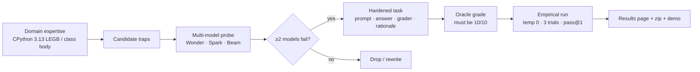

# PyScope method

**What judges can verify without API keys**

1. `python3 -m venv .venv && .venv/bin/pip install -r requirements.txt`
2. `.venv/bin/python -m unittest discover -s tests -v` — grader + task-shape + matrix guards
3. `.venv/bin/python graders/run_all.py` — oracle **10/10**
4. Compare headline table in README to `results/summary.json` / `results/RESULTS.md`

**What needs API keys (optional re-run)**

- `.venv/bin/python scripts/run_models.py` with keys from `.env.example` (Meta Wonder, Baseten Spark, Reflection Beam). Nebius was not used locally for the submitted matrix.
